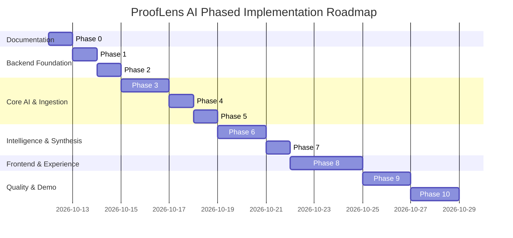

# ProofLens AI — Phased Implementation Plan

**Document ID:** PLAI-PLAN-001  
**Version:** 1.0 — Phase 0 Baseline  
**Status:** Under Review (Awaiting Phase 1 Authorization)  
**Target Product:** ProofLens AI — From Documents to Verifiable Answers  

---

## Roadmap Overview

---

## Phase 0: Technical Design and Implementation Planning (Current Phase)

- **Objective and Scope:**  
  Audit PRD requirements, inspect local runtime environment, formulate complete technical architecture (`TECHNICAL-DESIGN.md`), and produce a phased implementation plan (`IMPLEMENTATION-PLAN.md`). No application code or scaffolding is written.
- **Prerequisites and Dependencies:**  
  `ProofLens-AI-Project-Kickoff-PRD-v0.1.md` located and verified.
- **Tasks and Deliverables:**  
  1. Inspect local host environment (Python 3.13, Node v24, PostgreSQL 17 verified).
  2. Author `docs/TECHNICAL-DESIGN.md` addressing all 16 required technical areas.
  3. Author `docs/IMPLEMENTATION-PLAN.md` covering all phased milestones.
- **Files Created:**  
  - `docs/TECHNICAL-DESIGN.md`
  - `docs/IMPLEMENTATION-PLAN.md`
- **Tests and Verification:**  
  Verify documents exist, contain exhaustive coverage of all PRD functional requirements (FR-01 to FR-09), and confirm zero code files or external changes were executed.
- **Explicit Acceptance Criteria:**  
  - Both documentation files exist with full substantive content.
  - Zero package installations, git commits, or code files created.
  - Architectural consistency between database schema, endpoints, and workflows.
- **Definition of Done:**  
  Documentation complete, quality checklist verified, and explicit project owner approval requested prior to any Phase 1 execution.
- **Risks and Relevant Decisions:**  
  Unresolved choice of primary AI model API key (OpenAI vs. Gemini); mitigated by architecting an abstract provider interface.
- **Git Checkpoint:**  
  *(Awaiting owner authorization before git initialization/commit)*

---

## Phase 1: Project Foundation, Backend Skeleton, Configuration & Health Checks

- **Objective and Scope:**  
  Establish the backend Python environment, directory tree, dependency manifests, centralized Pydantic settings, structured logging, and operational `/health` and `/ready` endpoints.
- **Prerequisites and Dependencies:**  
  Approval of Phase 0. Python 3.11+ installed.
- **Tasks and Expected Deliverables:**  
  1. Initialize `backend/` directory structure and virtual environment.
  2. Create `pyproject.toml` / `requirements.txt` with pinned dependencies (`fastapi`, `uvicorn`, `pydantic-settings`, `sqlalchemy`, `asyncpg`, `pytest`).
  3. Create `app/core/config.py` using Pydantic `BaseSettings` reading from `.env`.
  4. Create `app/core/logging.py` for structured console logging.
  5. Implement `app/main.py` with FastAPI factory, CORS middleware, and global exception handlers.
  6. Implement `app/api/v1/health.py` with `/api/v1/health` and `/api/v1/ready`.
- **Files Expected to be Created:**  
  - `backend/requirements.txt`
  - `backend/.env.example`
  - `backend/app/main.py`
  - `backend/app/core/config.py`
  - `backend/app/core/logging.py`
  - `backend/app/core/exceptions.py`
  - `backend/app/api/v1/health.py`
  - `backend/tests/unit/test_health.py`
- **Tests and Verification:**  
  - `pytest backend/tests/unit/test_health.py` &rarr; verifies 200 OK on `/api/v1/health`.
  - Manual verification: `uvicorn app.main:app --reload` returns `{"status": "healthy"}`.
- **Acceptance Criteria:**  
  - Clean local startup without warnings or errors.
  - `/api/v1/health` returns `200 OK` with application metadata.
  - Configuration safely loads defaults when optional environment variables are omitted.
- **Definition of Done:**  
  Backend starts cleanly, tests pass, and zero database/AI dependencies are invoked yet.
- **Git Commit Checkpoint:**  
  `feat(backend): initialize backend skeleton, configuration, and health endpoints`

---

## Phase 2: Database Layer, SQLAlchemy Models, Alembic Migrations & pgvector

- **Objective and Scope:**  
  Configure asynchronous SQLAlchemy engine, implement ORM entities for Workspaces, Documents, Pages, Chunks, and Runs, and establish Alembic migrations including the `pgvector` extension.
- **Prerequisites and Dependencies:**  
  Completion of Phase 1. PostgreSQL 17 running locally.
- **Tasks and Expected Deliverables:**  
  1. Configure `app/core/database.py` with `create_async_engine` and session dependency.
  2. Implement ORM models: `Workspace`, `Document`, `DocumentPage`, `DocumentChunk`, `QueryRun`, `Answer`, `Citation`.
  3. Initialize Alembic with `alembic init -t async alembic`.
  4. Write migration `001_enable_pgvector.py` and `002_create_initial_schema.py`.
  5. Verify migration execution (`alembic upgrade head`) and downgrade path.
- **Files Expected to be Created:**  
  - `backend/app/core/database.py`
  - `backend/app/models/workspace.py`
  - `backend/app/models/document.py`
  - `backend/app/models/chunk.py`
  - `backend/app/models/query.py`
  - `backend/alembic/env.py`
  - `backend/alembic/versions/001_initial_schema.py`
  - `backend/tests/integration/test_database.py`
- **Tests and Verification:**  
  - Run `alembic upgrade head` on test database.
  - `pytest backend/tests/integration/test_database.py` &rarr; verifies CRUD operations on `Workspace` and `DocumentChunk`.
- **Acceptance Criteria:**  
  - `alembic upgrade head` runs idempotently without error.
  - PostgreSQL schema contains `vector` extension and all 8 relational tables.
  - Foreign key cascades cleanly delete children when a workspace or document is deleted.
- **Definition of Done:**  
  Schema applied, automated integration test confirms database persistence and vector column compatibility.
- **Git Commit Checkpoint:**  
  `feat(db): configure async sqlalchemy, pgvector models, and alembic migrations`

---

## Phase 3: Document Ingestion, PDF Validation, Page-Aware Parsing & Storage

- **Objective and Scope:**  
  Implement secure multi-page PDF upload, MIME/size validation, page-level text extraction with physical page preservation, empty/scanned document detection, and local file storage.
- **Prerequisites and Dependencies:**  
  Completion of Phase 2. `pypdf` dependency installed.
- **Tasks and Expected Deliverables:**  
  1. Implement `app/services/document_service.py` for file saving and extraction.
  2. Implement page-aware extraction preserving `page_number = i + 1`.
  3. Add scanned PDF heuristic (`< 40` chars/page average triggers `UNSUPPORTED_SCANNED_PDF`).
  4. Implement duplicate upload detection via SHA-256 hash.
  5. Expose `POST /api/v1/workspaces/{id}/documents`, `GET /documents`, `DELETE /documents/{id}`.
- **Files Expected to be Created:**  
  - `backend/app/services/document_service.py`
  - `backend/app/schemas/document.py`
  - `backend/app/api/v1/documents.py`
  - `backend/tests/unit/test_pdf_extraction.py`
  - `backend/tests/integration/test_document_upload.py`
  - `backend/tests/fixtures/sample_report.pdf`
- **Tests and Verification:**  
  - Upload valid 3-page test PDF &rarr; verify `document_pages` contains 3 distinct rows matching text per page.
  - Upload non-PDF file &rarr; verify `400 Bad Request`.
  - Upload file > 10MB &rarr; verify `413 Payload Too Large`.
  - Delete document &rarr; verify file removed from disk and database records deleted.
- **Acceptance Criteria:**  
  - Page provenance is 100% faithful to the source PDF physical page numbers.
  - Ingestion errors are caught cleanly and recorded in document status (`FAILED`).
- **Definition of Done:**  
  Ingestion API operational, fully tested with unit and integration tests.
- **Git Commit Checkpoint:**  
  `feat(ingestion): implement pdf validation, page-aware text extraction, and storage`

---

## Phase 4: Chunking Engine, Embedding Provider Interface & Vector Persistence

- **Objective and Scope:**  
  Implement the sliding-window text chunker with strict page isolation, the decoupled AI embedding provider interface, and pgvector batch persistence.
- **Prerequisites and Dependencies:**  
  Completion of Phase 3. Valid embedding provider credentials or mock adapter.
- **Tasks and Expected Deliverables:**  
  1. Implement `app/services/chunking_service.py` (500 char chunk, 100 char overlap, page boundaries respected).
  2. Implement abstract `EmbeddingProvider` protocol and `OpenAIEmbeddingProvider` implementation.
  3. Implement mock embedding provider for deterministic unit testing without API costs.
  4. Connect ingestion pipeline to automatically chunk and embed pages upon upload.
  5. Persist chunk records into `document_chunks` with `embedding` vectors.
- **Files Expected to be Created:**  
  - `backend/app/services/chunking_service.py`
  - `backend/app/services/embedding_service.py`
  - `backend/app/schemas/chunk.py`
  - `backend/tests/unit/test_chunking.py`
  - `backend/tests/integration/test_embedding_persistence.py`
- **Tests and Verification:**  
  - `pytest backend/tests/unit/test_chunking.py` &rarr; verifies no chunk crosses page boundaries.
  - Verify chunk embedding vectors are successfully stored and retrieved from PostgreSQL.
- **Acceptance Criteria:**  
  - Every chunk has correct `document_id`, `page_number`, `chunk_index`, and non-null 1536-dim vector.
  - Chunking is 100% deterministic given the same input text.
- **Definition of Done:**  
  Uploaded documents are automatically parsed, chunked, embedded, and indexed with status `READY`.
- **Git Commit Checkpoint:**  
  `feat(embeddings): implement sliding chunker, embedding provider, and vector persistence`

---

## Phase 5: Semantic Retrieval Engine & Relevance Scoring

- **Objective and Scope:**  
  Implement vector similarity search in PostgreSQL using `pgvector` cosine similarity, supporting workspace filtering, document subsets, similarity thresholds, and top-k limits.
- **Prerequisites and Dependencies:**  
  Completion of Phase 4.
- **Tasks and Expected Deliverables:**  
  1. Implement `app/services/retrieval_service.py` with cosine distance query logic (`<=>`).
  2. Add relevance filtering to reject chunks below the configured threshold (default 0.65).
  3. Expose testable retrieval function returning ranked passages with metadata.
  4. Write unit and integration retrieval tests.
- **Files Expected to be Created:**  
  - `backend/app/services/retrieval_service.py`
  - `backend/tests/unit/test_retrieval.py`
- **Tests and Verification:**  
  - Ingest test document containing specific terminology (e.g., "Revenue was 14M").
  - Query with semantic variation (e.g., "How much money was earned?") &rarr; target chunk ranked in Top-1.
  - Query with out-of-domain terms &rarr; returns empty list due to threshold filtering.
- **Acceptance Criteria:**  
  - Retrieval completes in $< 100\text{ms}$ on typical document collections.
  - Out-of-workspace documents are never returned.
- **Definition of Done:**  
  Retrieval service operational, tested, and ready to feed the Q&A generation layer.
- **Git Commit Checkpoint:**  
  `feat(retrieval): implement pgvector cosine search, ranking, and threshold filtering`

---

## Phase 6: Grounded Q&A Generation, Prompt Boundaries & Server-Side Citation Validation

- **Objective and Scope:**  
  Implement the grounded Q&A generation pipeline, prompt engineering with strict epistemic limits, automated abstention logic, and server-side citation validation to prevent hallucinated citations.
- **Prerequisites and Dependencies:**  
  Completion of Phase 5. LLM API access or mock LLM adapter.
- **Tasks and Expected Deliverables:**  
  1. Implement `app/services/qa_service.py` with structured prompt templates.
  2. Implement `app/services/citation_service.py` with regex parsing and provenance cross-referencing.
  3. Implement abstention handler for low-similarity or zero-evidence queries.
  4. Expose `POST /api/v1/workspaces/{id}/query`.
  5. Persist `QueryRun`, `Answer`, and verified `Citation` records.
- **Files Expected to be Created:**  
  - `backend/app/services/qa_service.py`
  - `backend/app/services/citation_service.py`
  - `backend/app/schemas/query.py`
  - `backend/app/api/v1/queries.py`
  - `backend/tests/unit/test_citation_validation.py`
  - `backend/tests/unit/test_abstention_policy.py`
  - `backend/tests/integration/test_qa_pipeline.py`
- **Tests and Verification:**  
  - Valid question &rarr; returns grounded answer with `VERIFIED` citations matching true chunks.
  - Unanswerable question &rarr; returns `is_abstained: true` with standardized explanation.
  - Model generates fake citation &rarr; server strips citation, logs warning, and flags status.
- **Acceptance Criteria:**  
  - Zero unverified citations returned to the caller.
  - Clear distinction between supported answers and abstained responses.
- **Definition of Done:**  
  Grounded Q&A endpoint operational with 100% server-verified citation integrity.
- **Git Commit Checkpoint:**  
  `feat(qa): implement grounded generation, prompt boundary guardrails, and citation validator`

---

## Phase 7: Cross-Document Comparison Engine

- **Objective and Scope:**  
  Implement multi-document comparison capabilities allowing users to analyze a topic across $\ge 2$ documents, generating per-document findings, citation anchors, and consensus analysis.
- **Prerequisites and Dependencies:**  
  Completion of Phase 6.
- **Tasks and Expected Deliverables:**  
  1. Implement `app/services/comparison_service.py`.
  2. Execute partitioned vector retrieval per document.
  3. Synthesize comparative analysis with consensus classification (`AGREEMENT`, `DIFFERENCE`, `CONTRADICTION`, `INCOMPARABLE_SCOPES`).
  4. Expose `POST /api/v1/workspaces/{id}/compare`.
- **Files Expected to be Created:**  
  - `backend/app/services/comparison_service.py`
  - `backend/app/schemas/comparison.py`
  - `backend/app/api/v1/comparisons.py`
  - `backend/tests/integration/test_comparison.py`
- **Tests and Verification:**  
  - Provide 2 documents with known conflicting facts &rarr; verify consensus classified as `DIFFERENCE` or `CONTRADICTION` with citations from both files.
- **Acceptance Criteria:**  
  - Comparison output strictly grounded; does not invent artificial contradictions.
- **Definition of Done:**  
  Cross-document comparison API functional with full citation traceability.
- **Git Commit Checkpoint:**  
  `feat(comparison): implement cross-document comparative analysis and consensus detection`

---

## Phase 8: Next.js Frontend Foundation, UI Workspace, Evidence Viewer & Comparison Matrix

- **Objective and Scope:**  
  Build the Next.js 14 TypeScript user interface featuring a modern workspace dashboard, document dropzone with live status badges, grounded Q&A interface, interactive Evidence Drawer, and Comparison Matrix.
- **Prerequisites and Dependencies:**  
  Backend APIs operational (Phases 1-7). Node.js v20+ installed.
- **Tasks and Expected Deliverables:**  
  1. Initialize Next.js 14 App Router project with Tailwind CSS and TypeScript.
  2. Implement type-safe API client (`src/lib/api-client.ts`).
  3. Implement Workspace & Document Library with PDF drag-and-drop.
  4. Implement Q&A chat interface with interactive `CitationPill` components.
  5. Implement `EvidenceDrawer` displaying source passage, page number, and similarity score.
  6. Implement Comparison Matrix view (`/workspaces/[id]/compare`).
  7. Implement responsive, high-contrast dark/light theme with clear abstention callouts.
- **Files Expected to be Created:**  
  - `frontend/src/app/workspaces/[workspaceId]/page.tsx`
  - `frontend/src/app/workspaces/[workspaceId]/compare/page.tsx`
  - `frontend/src/components/documents/DocumentUploadDropzone.tsx`
  - `frontend/src/components/qa/AnswerCard.tsx`
  - `frontend/src/components/qa/CitationPill.tsx`
  - `frontend/src/components/evidence/EvidenceDrawer.tsx`
  - `frontend/src/components/comparison/ComparisonMatrix.tsx`
  - `frontend/src/lib/api-client.ts`
- **Tests and Verification:**  
  - Vitest component tests for `CitationPill`, `AbstentionAlert`, and `DocumentUploadDropzone`.
  - Manual end-to-end user journey test in browser.
- **Acceptance Criteria:**  
  - Clean, responsive UI with zero layout shifts.
  - Clicking any citation immediately opens the Evidence Drawer with exact source context.
  - Clear visual indicator for abstained answers.
- **Definition of Done:**  
  Frontend fully interactive and connected to live backend APIs.
- **Git Commit Checkpoint:**  
  `feat(frontend): implement nextjs workspace, evidence inspector drawer, and comparison matrix`

---

## Phase 9: Evaluation Suite, Benchmark Runner, Negative Abstention & Demo Readiness

- **Objective and Scope:**  
  Build the repeatable evaluation test suite, curate a standard college demo document set and benchmark questions, implement security/injection defenses, and finalize end-to-end documentation.
- **Prerequisites and Dependencies:**  
  Completion of Phase 8.
- **Tasks and Expected Deliverables:**  
  1. Create curated test fixture dataset (`tests/fixtures/eval_dataset_v1.json`).
  2. Implement CLI evaluation command (`python -m app.services.evaluation_service`).
  3. Implement frontend evaluation report view (`/workspaces/[id]/evaluation`).
  4. Execute prompt-injection resilience tests (PDFs containing malicious system instructions).
  5. Prepare demo scripts and sample documents for the college portfolio presentation.
- **Files Expected to be Created:**  
  - `backend/app/services/evaluation_service.py`
  - `backend/tests/fixtures/eval_dataset_v1.json`
  - `backend/tests/security/test_prompt_injection.py`
  - `frontend/src/app/workspaces/[workspaceId]/evaluation/page.tsx`
  - `README.md` (End-to-end setup and local running guide)
- **Tests and Verification:**  
  - Run evaluation suite: confirms Retrieval Hit Rate $\ge 85\%$, Citation Validity $100\%$, Abstention Accuracy $100\%$.
  - Prompt injection test: confirms adversarial PDF text cannot hijack system instructions.
- **Acceptance Criteria:**  
  - All acceptance criteria from PRD Section 12 satisfied.
  - Complete demo reproducible by another developer without manual intervention.
- **Definition of Done:**  
  Full MVP verified, test suite passes, and project ready for college presentation.
- **Git Commit Checkpoint:**  
  `feat(eval): finalize evaluation suite, prompt injection defenses, and demo readiness`

---

## Phase 10: (Optional Future Enhancements — Post-MVP)

*These items are explicitly marked as optional and are NOT prerequisites for MVP completion.*
- **Dockerization:** Multi-container `docker-compose.yml` packaging PostgreSQL/pgvector, FastAPI, and Next.js for one-click deployment.
- **OCR Engine:** Tesseract / PaddleOCR integration for scanned images and low-text PDFs.
- **Multi-Tenant Authentication:** NextAuth / Supabase Auth integration with workspace RBAC.
- **Background Worker Queue:** Celery / Redis worker for high-concurrency PDF processing.
